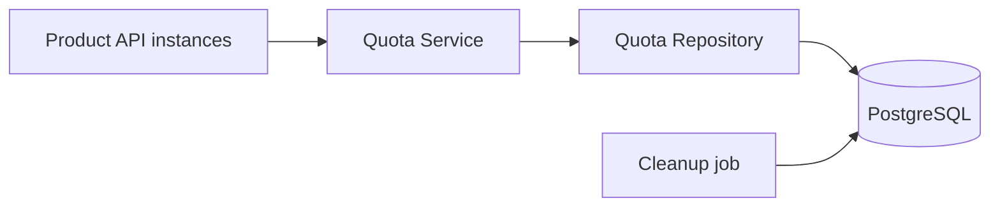

# Per-Customer Quota Metering

## 1. Overview

Each organization gets a monthly quota for each feature. A request can consume multiple units, and requests for the same organization
may arrive concurrently on different API instances.

The main requirement is to never exceed the configured quota. A request must either get all requested units or none. Retries must not charge twice, and confirmed downstream failures must be refundable.

## 2. Requirements

### Functional Requirements

1. Clients should be able to consume quota for a specific organization and feature by requesting a given number of units.
2. If requested units exceed remaining quota, the request should be rejected without deducting anything, returning error with 429 status and message `Quota limit exceeded`.
3. Retrying a same request again should return the previous response without charging again.
4. If a downstream operation fails, consumed quota should be refunded only when failure is confirmed.
5. Clients should be able to check total usage, remaining quota, and the next reset time for an organization and feature.
6. Quota limits should support feature-level defaults and organization-specific overrides.

### Non-Functional Requirements

1. Concurrent requests across multiple service instances must never cause usage to exceed the configured quota.
2. Quota usage must never become negative or exceed the configured limit.
3. Quota enforcement should add less than 10ms overhead per operation.
4. Quota state must be consistent across all service instances.
5. The system should handle approximately 2,000 operations/sec sustained and 10,000 operations/sec at peak.

## 3. Architecture

A FastAPI service owns quota logic. Product API instances call it; they do not maintain local counters. PostgreSQL stores the shared usage counter, quota configuration, and operation history.



`QuotaService` handles validation and operation state transitions. The
repository contains SQL and transaction handling. A sample consumer
calls `consume`, runs downstream work, then calls `finalize` or `refund`
based on the response of downstream services.

## 4. Key design decisions

### 4.1 Database Choice

We needed to store three things:

- **Quota config:** Monthly limits for each feature, including org-specific overrides.
- **Quota usage:** Units consumed by each organization for each feature and billing period.
- **Quota operations:** Every consume operation's status and idempotency key. This helps prevent duplicate charges on retries and supports refunds when downstream operations fail.

I considered two approaches:

1. **PostgreSQL + Redis:** Store config and operation records in PostgreSQL, while using Redis for atomic quota counter updates.
2. **PostgreSQL only:** Store all three in PostgreSQL and use conditional atomic updates for quota enforcement.

I chose PostgreSQL for everything because usage updates and operation records need to remain consistent. Keeping both in one transaction avoids cross-database coordination and simplifies failure handling. Redis offers faster counter operations, but introduces additional consistency and recovery complexity.

In PostgreSQL all instances update the same usage row. The deduction is
a single conditional update:

```sql
UPDATE quota_usage
SET used = used + :units
WHERE org_id = :org
  AND feature = :feature
  AND period = :period
  AND used <= quota_limit - :units
RETURNING used, quota_limit;
```

### 4.2 All-or-nothing units

A request for `N` units succeeds only when all `N` units are available.
Otherwise, nothing is deducted and the API returns `429` with the
requested amount, remaining quota, and reset time.

This keeps retries simple and avoids partially allocating units.

> A request may be rejected even when some quota remains. The caller can retry with a smaller number of units.

### 4.3 Idempotency and downstream failures

Client generates a unique idempotency key scoped to `(org_id, feature)`. Each consume request includes this key. The operation record and quota deduction are committed in the same transaction.

The **Quota Operations** table maintains idempotency and tracks the status of each operation. It ensures that retries of the same operation do not result in multiple quota deductions.

**Suggested table structure:**

| Column            | Description                                         |
| ----------------- | --------------------------------------------------- |
| `operation_id`    | Unique ID for each operation                        |
| `org_id`          | Organization making the request                     |
| `feature`         | Feature for which quota is consumed                 |
| `idempotency_key` | Client-generated unique key                         |
| `request_units`   | Units requested                                     |
| `period`          | Original billing period in which quota was consumed |
| `status`          | `CHARGED`, `FINALIZED`, `REFUNDED`, `REJECTED`      |
| `response`        | Stored response for handling retries                |
| `created_at`      | Operation creation timestamp                        |
| `updated_at`      | Last status update timestamp                        |

Add a unique constraint on `(org_id, feature, idempotency_key)` to prevent duplicate operation records.

**Interaction:**

1. Client sends consume request with idempotency key.
2. Service checks Quota Operations for an existing key.
   - Same key and same payload: return stored result; do not charge again.
   - Same key with different payload: return `409 Conflict`.
3. If key is new, service checks available quota and creates operation record while deducting quota in the same transaction.
4. Consumer executes downstream operation using the returned `operation_id` as its idempotency token.
5. Based on downstream result:
   - **Success:** Mark operation `FINALIZED`.
   - **Confirmed failure (downstream did not execute):** Refund units and mark operation `REFUNDED`.
   - **Timeout or ambiguous result:** Keep operation `CHARGED`.

Ambiguous operations remain in `CHARGED` state until their outcome is resolved. A reconciliation process periodically identifies old `CHARGED` operations and reports them for investigation. We do not automatically refund these operations based only on their age, as the downstream operation may have succeeded.

This does not guarantee exactly-once execution across PostgreSQL and an independent downstream. It ensures at-most-once quota deduction per idempotency key during the retention window.

### 4.4 Monthly reset and usage

There are two approaches to handling monthly resets:

1. **Scheduled reset**: Run a background job at the start of every month to reset usage counters.
2. **Period-based usage**: Maintain separate usage records for each organization, feature, and billing period.

I chose the second approach because it avoids running a reset job across all organizations and features. It also preserves historical usage and avoids reset-job failures or partial resets.

When a consume request arrives, the service identifies the current billing period. If no usage record exists, it creates one with used = 0 and processes the request.

> [!NOTE]
> A billing period is the UTC calendar month: from the first day at
> `00:00 UTC` up to, but not including, the next month's first day.

**Quota configuration**

Limits come from a feature-level default, with an optional organization-specific override. I chose to copy the configured limit into the monthly usage record when it is created. This ensures that configuration changes do not silently affect an ongoing billing period.

An admin endpoint can update the current period's limit, but rejects any new limit below the already consumed usage.

**Usage API**

The usage endpoint returns:

- Billing period
- Configured limit
- Used units
- Remaining units
- Next reset time

If no usage record exists for the current period, the API returns `200 OK` with `used = 0` and the configured limit. I chose this instead of returning `404` because a missing usage record simply means no quota has been consumed yet, not that the organization or feature is missing.

## 5. Data model

The data model uses four main tables:

| Table                   | Purpose                                                                                                                |
| ----------------------- | ---------------------------------------------------------------------------------------------------------------------- |
| `quota_config_default`  | Stores default monthly quota limits for each feature.                                                                  |
| `quota_config_override` | Stores optional organization-specific limits for a feature.                                                            |
| `quota_usage`           | Maintains consumed units for each organization, feature, and billing period.                                           |
| `quota_operations`      | Tracks individual consume operations, including idempotency key, request details, status, and original billing period. |

**Key design decisions**

- `quota_usage` has a unique constraint on `(org_id, feature, period)` to ensure only one usage counter exists for each organization, feature, and month.
- A check constraint ensures `0 <= used <= quota_limit`, preventing invalid quota values at the database level.
- `quota_operations` has a unique constraint on `(org_id, feature, idempotency_key)` to prevent duplicate operations and quota deductions.
- Each operation stores its original billing period. This is important because retries or refunds may happen after a month boundary. Without storing the original period, a refund could incorrectly update the new month's usage instead of the month that was originally charged.

## 6. Failure handling

| Case                                     | Behavior                                                   |
| ---------------------------------------- | ---------------------------------------------------------- |
| PostgreSQL unavailable                   | Return `503`; fail closed rather than use a stale balance. |
| Insufficient quota                       | Return `429`; no units deducted.                           |
| Confirmed downstream failure             | Refund units in a transaction.                             |
| Downstream timeout or ambiguous response | Keep charge; do not refund until outcome is known.         |
| Same key and payload retried             | Replay stored result; do not charge again.                 |
| Same key with different payload          | Return `409 Conflict`.                                     |
| Same key retried after a refund          | Return `409 Conflict`; client must use a new key.          |

**Concurrency and consistency**

Consume and refund update the operation and usage records in one transaction. Both follow the same lock order: operation row first, usage row second. This avoids inconsistent updates and reduces deadlock risk.

`finalize` and `refund` are conditional on the operation still being `CHARGED`, ensuring only one transition can succeed if both requests race.

**Why these decisions?**

- **Fail closed:** If PostgreSQL is unavailable, the service cannot reliably verify remaining quota. Allowing requests using stale balances could cause over-consumption.
- **Atomic updates:** Operation status and quota usage must change together. Otherwise, a failed transaction could leave quota deducted without a corresponding operation or cause an incorrect refund.
- **Conditional transitions:** Prevent concurrent finalize/refund requests from processing the same operation twice.
- **No refund on timeout:** A timeout does not prove downstream execution failed. Refunding could give the customer free execution if the task actually completed.

## 7. Testing and performance

Tests use a real PostgreSQL instance because mocked or in-memory storage cannot demonstrate actual database row-locking and transaction behavior.

**Concurrency testing across multiple instances**

The mandatory concurrency test starts 100 concurrent requests of 10 units against a configured quota of 500, distributed round-robin across 4 running FastAPI service instances (ports 8001, 8002, 8003, and 8004) pointing to the same shared PostgreSQL database.

- **Exact command:**
  ```bash
  cd quota-metering && .venv/bin/pytest -k across_4_instances -v -s
  ```
- **Test execution evidence:**
  - 4 independent Uvicorn processes launched on ports 8001–8004.
  - Organization `multi_inst_org` and feature `multi_inst_feat` configured with limit 500.
  - 100 concurrent requests of 10 units dispatched simultaneously (25 requests per instance) via `asyncio.gather`.
  - Exactly 50 requests succeeded (`HTTP 200` with status `CHARGED`).
  - Exactly 50 requests were rejected (`HTTP 429` with message `Quota limit exceeded`).
  - Direct database query confirmed final usage was exactly 500 (`used = 500, quota_limit = 500`).
  - Zero over-consumption occurred.

**Quota Operation Overhead (<10ms target)**

Overhead was measured separately for the database function and the HTTP layer:

1. **Direct PostgreSQL overhead** (1,000 sequential calls to `fn_quota_consume`, from the benchmark run):
   - **p50:** 0.31 ms, **p95:** 0.62 ms
   - **Status:** PASS (<10ms target met)

2. **HTTP handler overhead** (sequential requests through the FastAPI app using httpx's in-process ASGI transport, real PostgreSQL):
   - **p50:** 2.39 ms, **p95:** 4.32 ms
   - This excludes the network hop and Uvicorn, so it measures routing, validation and the database call, not client-observed latency.
   - **Status:** PASS (<10ms target met)

**Other test cases**

- Mixed request sizes and concurrent first-time usage creation.
- Duplicate requests and idempotency key reuse with different payloads.
- 20 simultaneous retries of one new key: all replay one operation, one charge.
- Replaying a refunded key returns `409` with an explicit message.
- Retries and refunds across month boundaries.
- Concurrent finalize/refund requests race conditions.
- Missing quota configuration handling and admin limit updates rejecting limits below consumed usage, including under concurrent consumes.
- Cleanup job deletes only finished operations older than the retention window and never `CHARGED` ones.
- Database outage simulation verifying 503 fail-closed behavior.

**Load testing configuration & reproducibility**

Load testing used Locust with `FastHttpUser`, with each request sent to a randomly chosen one of 4 independent FastAPI/Uvicorn instances sharing one PostgreSQL database:

- **Reproduction command:**
  ```bash
  PYTHONPATH=src .venv/bin/python3 load_tests/run_benchmarks.py
  ```
- **Environment:**
  - Machine: Apple M1 Max (10 physical cores), macOS arm64
  - PostgreSQL: local instance over a Unix socket
  - Service setup: 4 Uvicorn instances on ports 8001-8004, asyncpg pool min=3, max=15 per instance
  - Load generator: Locust 2.47.0, headless, on the same machine
  - Setup: `/health` polling on every port, then limit seeding (`100,000,000` units) before traffic
- **Scenarios (15s each):**
  - *Sustained:* 60 users, spawn rate 20/s, spread over 5k organizations.
  - *Peak:* 150 users, spawn rate 50/s, spread over 5k organizations.
  - *Hot org:* 40 users, spawn rate 20/s, one organization and feature.

**Results (single run, achieved vs target)**

| Scenario | Target | Achieved Throughput | p50 | p95 | p99 | Errors | Outcome |
| :--- | :---: | :---: | :---: | :---: | :---: | :---: | :---: |
| 5k organizations, sustained | 2,000 req/s | **6,505.0 req/s** | 6 ms | 11 ms | 19 ms | 0 | **TARGET MET (3.3x)** |
| 5k organizations, peak | 10,000 req/s | **7,284.0 req/s** | 16 ms | 31 ms | 45 ms | 0 | **TARGET NOT MET (72.8%)** |
| Single hot organization/feature | Contention analysis | **2,758.3 req/s** | 7 ms | 36 ms | 62 ms | 0 | **Serialized (0 errors)** |

Numbers vary between runs because the load generator, services and database share one machine.

**Analysis of gaps and suspected bottlenecks**

1. **Peak throughput (7,284 req/s vs 10,000 req/s, not met):**
   - Running 8 instances instead of 4 did not help: throughput fell to about 5,700 req/s in both the sustained and peak scenarios (single run, 80/250/50 users, pool 2-10). More server processes only added contention, which points to a saturated machine rather than a quota-logic limit.
   - *Suspected bottleneck:* the load generator, the Uvicorn processes and PostgreSQL compete for the same 10 cores. This is not verified; no profiling was done.
   - *Production remediation:* run load generation from separate machines, put PgBouncer in front of PostgreSQL, and re-measure on dedicated hardware.

2. **Hot-organization ceiling:**
   - All requests for one organization and feature update a single row, so they serialize in the database. Doing the deduction inside `fn_quota_consume` keeps the lock short (one round trip).
   - Going well beyond this on one organization would need quota block leasing (Section 8), which trades strict accuracy for local allocation.

## 8. Scaling and limitations

The main bottlenecks are likely to be database connection-pool waits and contention on hot organization-feature rows. Since quota updates for the same organization and feature must be serialized, a heavily used organization can become a bottleneck.

**Scaling approach**

- **Connection pooling:** Tune pool size and use PgBouncer to manage database connections efficiently.
- **PostgreSQL function:** Move the consume transaction into a database function if multiple round trips increase latency or lock duration.
- **Sharding:** If a single PostgreSQL primary reaches its write-capacity limit, shard by `org_id`. This keeps all quota operations for an organization on the same shard.
- **Quota block leasing:** For exceptionally hot organizations, allocate quota blocks to service instances. This reduces database writes but can leave unused quota on one instance while another rejects requests due to its local allocation.

**Limitations and trade-offs**

- The service fails closed during PostgreSQL outages. This protects quota correctness but makes enforcement dependent on database availability.
- Idempotency is guaranteed only within the 24-hour retention window. A cleanup job (`purge_expired_operations`) deletes `FINALIZED`, `REFUNDED` and `REJECTED` operations older than that; retries after expiry may be treated as new operations. `CHARGED` operations are never purged.
- Organizations and features have no tables of their own. The calling product API authenticates the organization and is the source of truth for `org_id`, so the quota service does not validate it. A feature exists once it has a row in `quota_config_default` (or an override); consuming an unconfigured feature returns `404`. This avoids a second source of truth and an extra lookup on the hot path.
- Downstream reconciliation depends on downstream support for operation-status lookup or idempotent execution. Without either, ambiguous operations cannot be resolved automatically.

## 9. AI assistance

I used AI as a supporting tool during this assignment, mainly for reviewing the design, discussing trade-offs, refining documentation, and identifying potential edge cases.

**AI-assisted:**

- Reviewing the design and identifying potential concurrency and failure scenarios.
- Discussing alternative approaches, including Redis-based counters and reservation/commit workflows.
- Refining the structure and wording of `DESIGN.md`.
- Reviewing test scenarios and identifying additional edge cases.
- Writing implementation code, including service logic and supporting components.

**My design decisions:**

I started by defining the functional and non-functional requirements before deciding on the architecture. Key decisions included:

- Choosing an **all-or-nothing** approach for batch consumption instead of partial consumption.
- Selecting PostgreSQL as the shared source of truth instead of combining PostgreSQL with Redis (Lua counters), to maintain consistency and idempotency without adding architectural complexity.
- Using conditional atomic quota deduction to prevent over-consumption.
- Introducing idempotency keys and operation tracking to prevent duplicate charges.
- Following a deduct-first, refund-on-confirmed-failure approach.
- Using UTC calendar-month billing periods with lazy usage-row creation.
- Failing closed during database outages.
- Using database transactions and conditional state transitions to maintain consistency.
